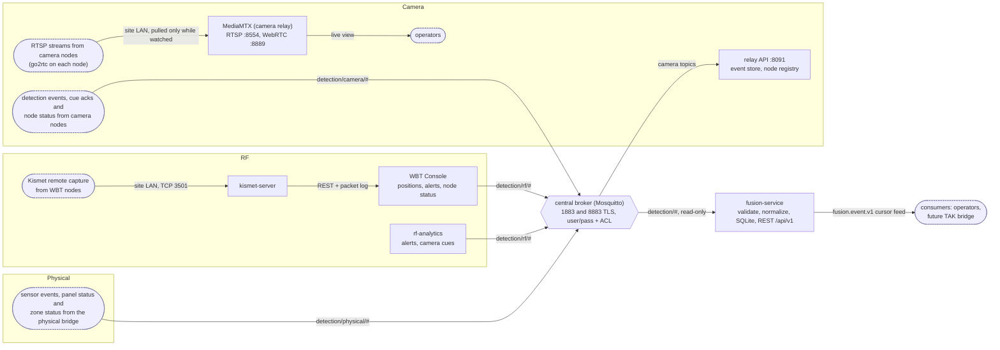

# Fusion architecture

The services on the central node and how each subsystem's output reaches the fusion service.
Edge hardware (camera nodes, WBT nodes, the alarm panel and its bridge host) appears only as
the inputs it sends. Each subsystem's `DESIGN.md` and MQTT contract remain the source of truth
for what happens before those inputs leave the edge.

Related: [`fusion-service/DESIGN.md`](fusion-service/DESIGN.md),
[`fusion-service/API-CONTRACT.md`](fusion-service/API-CONTRACT.md),
[`camera-subsystem/DESIGN.md`](camera-subsystem/DESIGN.md) section 5,
[`rf-subsystem/MQTT-CONTRACT.md`](rf-subsystem/MQTT-CONTRACT.md),
[`physical-subsystem/MQTT-CONTRACT.md`](physical-subsystem/MQTT-CONTRACT.md).

## Central node

Dashed boxes are inputs and outputs that live off the node; every solid box is a service on the
central node. The hexagon is the MQTT broker. The only datastore is fusion's SQLite, inside the
fusion-service box. All of it runs from the repo-root `compose.yaml`.

One broker. Every publisher has its own login and may write only under its own prefix; fusion
reads `detection/#` (`detection/central-broker/aclfile`). The broker listens on 1883 (login) and
8883 (TLS, the Let's Encrypt certificate) on the server's address. Fusion's single broker entry,
`id: central` in `detection/central/fusion.config.yaml`, takes all three subsystems under site
`sh1`. Fusion, the RF console and rf-analytics reach the broker inside Docker; the camera relay API uses
the server's own address on 1883; nodes reach it on the LAN, and the physical bridge on the LAN or,
when it runs on the same server, on the Docker network `black-relay-local`.

The WBT Console is in the RF data path, not beside it. Kismet has no MQTT output in this stack:
the console polls Kismet's REST API and packet log, computes positions and node status, and is
the process that publishes positions and node status under `detection/rf/` (`console/publish.py`).
rf-analytics publishes the RF alerts and the camera cues.

Camera events and camera video take different paths. Events leave each node over MQTT, land on
the central broker, and fusion subscribes to them there. Video never enters MQTT: MediaMTX in the
camera relay pulls each node's RTSP stream on demand and serves one endpoint to operators
(`rtsp://viewer:<password>@<server>:8554/<node_id>`, or WebRTC at `http://<server>:8889/<node_id>`
with UDP 8189 for media). The relay API subscribes to the camera topics with its own read-only
login for the camera subsystem's event store and node registry (that is how MediaMTX learns node
addresses), but it is not part of fusion's path.

## Inputs to fusion

| Input | Topic | Schema | QoS | Broker |
|---|---|---|---|---|
| detection event from camera | `detection/camera/detections` | `camera.detection.v0` | 1 (updates 0) | central broker |
| cue ack from camera | `detection/camera/cue-acks` | `camera.cue-ack.v0` | 1 | central broker |
| node status from camera | `detection/camera/status/nodes` | `camera.node-status.v0` | 1 | central broker |
| position estimate from RF | `detection/rf/positions` | `rf.position.v0` | 0 | central broker |
| alert from RF | `detection/rf/alerts` | `rf.alert.v0` | 1 | central broker |
| node status from RF | `detection/rf/status/nodes` | `rf.node-status.v0` | 1 | central broker |
| sensor event from physical | `detection/physical/events` | `physical.event.v0` | 1 | central broker |
| panel status from physical | `detection/physical/status/panel` | `physical.panel-status.v0` | 1 | central broker |
| zone status from physical | `detection/physical/status/zones` | `physical.zone-status.v0` | 1 | central broker |

Fusion validates each message against the owning subsystem's JSON schema, wraps it in
`fusion.event.v1`, stores it in SQLite, and acknowledges QoS 1 only after commit. The three
node and panel status topics also update the latest-status snapshot at `/api/v1/nodes`.

## Deployment facts

- Fusion runs in the repo-root `compose.yaml` beside the broker, the RF services and the camera
  relay, and reaches the broker as `broker:1883` inside Docker.
- Fusion logs in as the read-only `fusion` user (`FUSION_CENTRAL_MQTT_USER` and
  `FUSION_CENTRAL_MQTT_PASSWORD`) with its own client id.
- One fusion process per SQLite file; persistent MQTT sessions with client ids unique on the broker.
- The fusion image is built from `detection/` so it carries every subsystem's `schemas/`.
- Publishers authenticate with their own logins; TLS on 8883 is available to every client. The
  services in the central project use the plain 1883 listener.
