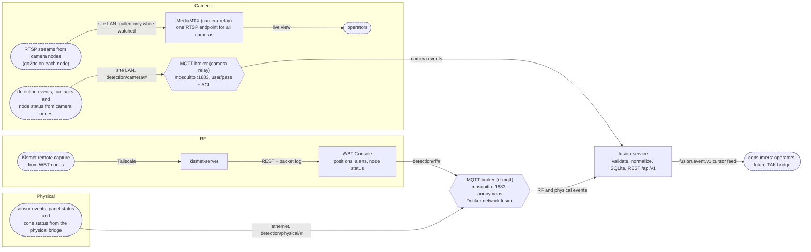

# Fusion architecture

The services on the central node and how each subsystem's output reaches the fusion service.
Edge hardware (camera nodes, WBT nodes, the alarm panel and its bridge host) appears only as
the inputs it sends. Each subsystem's `DESIGN.md` and MQTT contract remain the source of truth
for what happens before those inputs leave the edge.

Related: [`fusion-service/DESIGN.md`](fusion-service/DESIGN.md),
[`fusion-service/API-CONTRACT.md`](fusion-service/API-CONTRACT.md),
[`camera-subsystem/DESIGN.md`](camera-subsystem/DESIGN.md) section 5,
[`rf-subsystem/MQTT-CONTRACT.md`](rf-subsystem/MQTT-CONTRACT.md),
[`physical-subsystem/MQTT-CONTRACT.md`](physical-subsystem/MQTT-CONTRACT.md).

## Central node

Dashed boxes are inputs and outputs that live off the node; every solid box is a service on the
central node. Hexagons are MQTT brokers. The only datastore is fusion's SQLite, inside the
fusion-service box.

Two brokers, not one. The camera relay's broker is authenticated and published on the site LAN.
The RF stack's broker is anonymous and reachable only on the Docker network `fusion`; the
physical bridge publishes to it as the team broker over the wired LAN. Fusion subscribes to both
and serves one cursor feed.

The WBT Console is in the RF data path, not beside it. Kismet has no MQTT output in this stack:
the console polls Kismet's REST API and packet log, computes positions and node status, and is
the process that publishes `detection/rf/#` (`console/publish.py`).

Camera events and camera video take different paths. Events leave each node over MQTT, land on
the camera-relay broker, and fusion subscribes to them there. Video never enters MQTT: MediaMTX
in the camera-relay bundle pulls each node's RTSP stream on demand and serves one endpoint to
operators. The bundle's relay API also subscribes to the broker for the camera subsystem's own
event store and node registry (that is how MediaMTX learns node addresses), but it is not part
of fusion's path and is left off the chart.

## Inputs to fusion

| Input | Topic | Schema | QoS | Broker |
|---|---|---|---|---|
| detection event from camera | `detection/camera/detections` | `camera.detection.v0` | 1 (updates 0) | camera broker |
| cue ack from camera | `detection/camera/cue-acks` | `camera.cue-ack.v0` | 1 | camera broker |
| node status from camera | `detection/camera/status/nodes` | `camera.node-status.v0` | 1 | camera broker |
| position estimate from RF | `detection/rf/positions` | `rf.position.v0` | 0 | rf-mqtt |
| alert from RF | `detection/rf/alerts` | `rf.alert.v0` | 1 | rf-mqtt |
| node status from RF | `detection/rf/status/nodes` | `rf.node-status.v0` | 1 | rf-mqtt |
| sensor event from physical | `detection/physical/events` | `physical.event.v0` | 1 | rf-mqtt |
| panel status from physical | `detection/physical/status/panel` | `physical.panel-status.v0` | 1 | rf-mqtt |
| zone status from physical | `detection/physical/status/zones` | `physical.zone-status.v0` | 1 | rf-mqtt |

Fusion validates each message against the owning subsystem's JSON schema, wraps it in
`fusion.event.v1`, stores it in SQLite, and acknowledges QoS 1 only after commit. The three
node and panel status topics also update the latest-status snapshot at `/api/v1/nodes`.

## Deployment facts

- Fusion runs on the same host as the RF stack and joins the Docker network `fusion`
  (`compose.fusion.yaml`); `rf-mqtt` publishes no host port.
- Fusion needs a read-only account on the camera broker for the three camera topics and a
  client id of its own.
- One fusion process per SQLite file; persistent MQTT sessions with client ids unique on each
  broker.
- The fusion image is built from `detection/` so it carries every subsystem's `schemas/`.
- Anonymous plaintext on the team broker is a v0 concession; both RF and physical contracts say
  so, and the physical bridge and fusion support TLS and credentials when the broker does.
